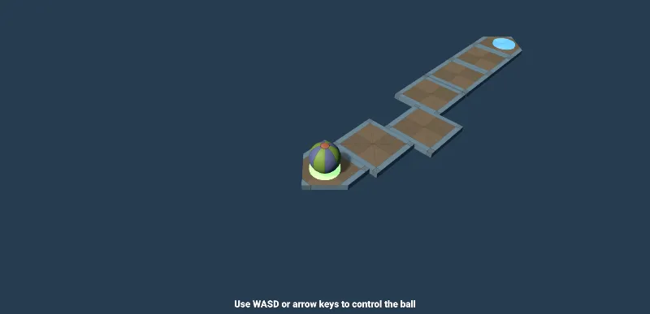
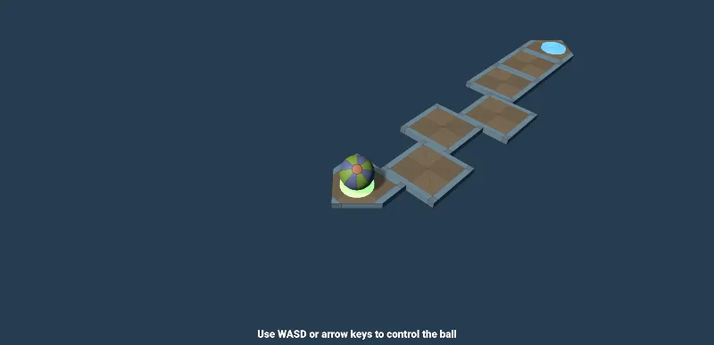
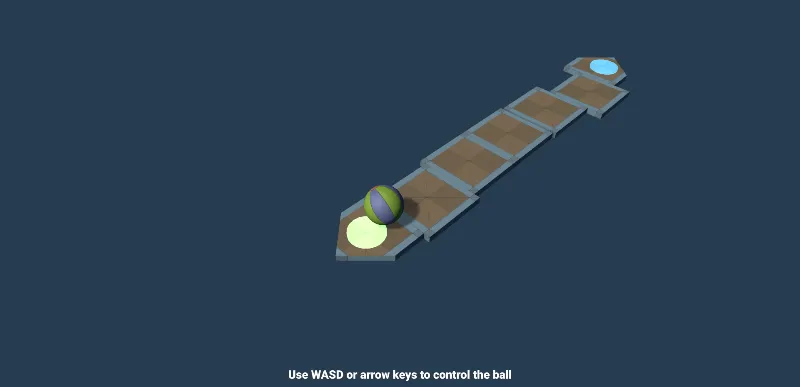
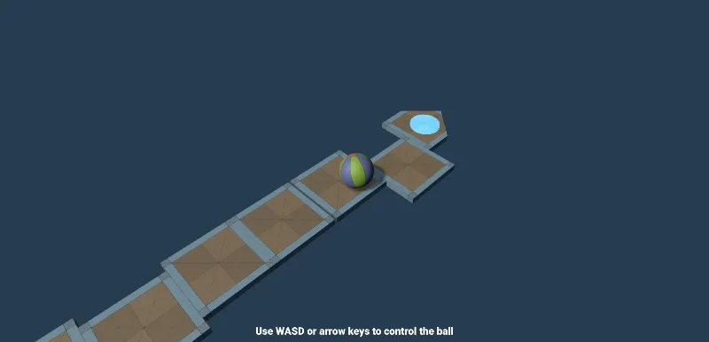
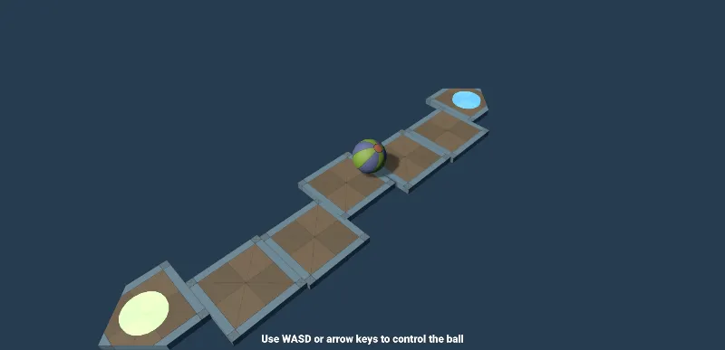

# Ball Demo

A small PlayCanvas physics game: roll a ball across a row of sliding platforms and reach the teleporter at the far end.

Each square slides at its own random speed and pauses at random, so the path is never lined up the same way twice:

### A run across the squares

| 1. Leaving the start pad | 2. Crossing the squares | 3. Heading for the teleporter |
| --- | --- | --- |
|  |  |  |

*Screenshots captured from the running app (PlayCanvas Launch, engine 2.23.1).*

## Controls

| Key | Action |
| --- | --- |
| `W` / `↑` | Roll forward |
| `S` / `↓` | Roll back |
| `A` / `←` | Roll left |
| `D` / `→` | Roll right |
| **Center on Ball** button (top right) | Snap the camera to a wider view of the ball and its surroundings |

Controls are rotated 45° to match the camera, so the path runs diagonally on screen: hold **W + D** to roll straight along it. If the ball falls off, it respawns at its last checkpoint.

## How the level works

- **Start pad → five sliding squares → arrow platform → teleporter.** Stepping on the teleporter sends the ball back to the start pad.
- **Sliding squares** move left and right. Each square picks its own random speed and pauses for a random time at each end, so no two squares move in step.
- **Invisible side walls** ride along with every square, so the ball can't roll off its left or right edge. The front and back are left open so the ball can roll from one square to the next.
- **Follow camera** stays at a fixed angle behind the ball and smoothly tracks it.

## Scripts

| Script | Attached to | Purpose |
| --- | --- | --- |
| [`movement.js`](scripts/movement.js) | Ball | Turns keyboard input into impulses, rotated 45° to match the camera; respawns the ball if it falls |
| [`follow-camera.js`](scripts/follow-camera.js) | Camera | Eases the camera toward a fixed offset from the ball |
| [`center-view-button.js`](scripts/center-view-button.js) | Camera | Adds the **Center on Ball** button; `viewDistance` sets how wide the view is |
| [`platform-mover.js`](scripts/platform-mover.js) | Each square | Ping-pong motion with random speed (`minSpeed`–`maxSpeed`) and random end pauses (`minDelay`–`maxDelay`) |
| [`teleporter.js`](scripts/teleporter.js) | Teleporter | On trigger, teleports the ball to the target entity |

Physics is handled by Ammo.js ([`ammo.js/`](ammo.js/)).

## Running it

Open the project in the PlayCanvas Editor and press **Launch**. Scene data (entities, walls, materials) lives in the Editor project; this repository holds the scripts.
